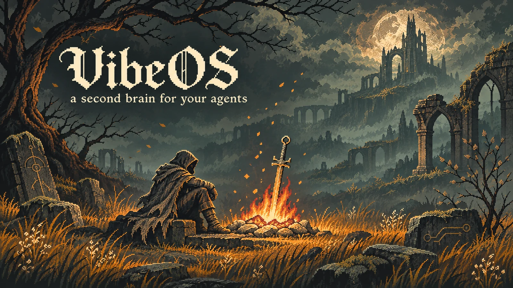
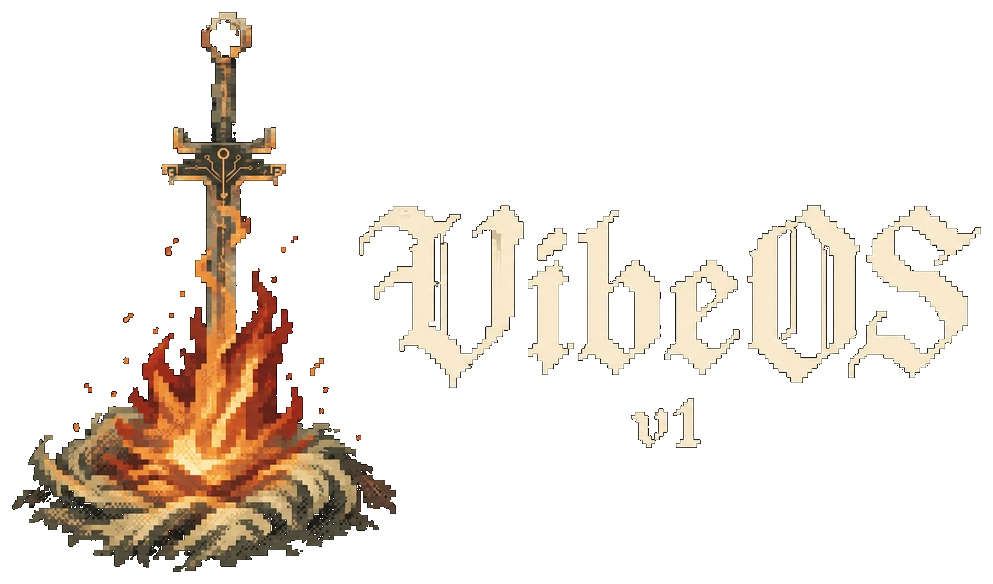

<p align="center">
  
</p>

<p align="center">
  
  
  
</p>

<p align="center"></p>

<p align="center"><b>Yapay zekâ ajanların için kalıcı hafıza. Tek ateş, tüm sistem.</b><br>
<sub>Claude Code · Codex · Hermes · OpenCode · Antigravity · Kiro</sub></p>

---

## ▸ VibeOS nedir

VibeOS, ajanlarına **oturumlar ve makineler arasında kalıcı hafıza** veren, Markdown tabanlı bir
ikinci beyin kurulumudur. Notların senin klasöründe, düz Markdown olarak durur; hiçbir SaaS
hafızasına kilitli değildir.

Çok proje yürütüyorsan sorun hep aynıdır: her yeni oturumda ajana her şeyi baştan anlatırsın,
"o projede en son ne yapmıştık" sorusunun cevabı beş farklı sohbete dağılmıştır. VibeOS bunu
çözer: ajan oturuma başlarken kim olduğunu, hangi kurallarla çalıştığını, son oturumda ne
kaldığını ve sorduğun konunun kaynak notlarını hazır bulur.

Bu sistem, [Cansın Cengiz](https://cansincengiz.me)'in kendi günlük kullandığı kurulumun
paylaşılabilir hali. İçindeki her kural sahada bir şey kırıldıktan sonra yazıldı.

---

## ▸ Tek ateşle kurulum

<p align="center"></p>

Not klasörünü (ya da boş bir klasörü) ajanında aç ve şunu yaz:

```text
https://cansincengiz.me/vibeos.md adresini oku. Bu klasöre VibeOS'u kur. Mevcut bir ikinci
beyin ya da not sistemi varsa notlarımı koruyarak ona uyarla; VibeOS daha önce kurulduysa
eksik modülleri tamamla ve güncelle. Gerekli indirme ve kurulum adımlarını sen yap. Sonunda
örnek bir bilgiyi kaydedip yeni oturumda geri okuyarak birlikte doğrulayalım.
```

Ajan şunları kendisi yapar:

1. **Keşif:** klasörde ne olduğuna bakar. Obsidian, PARA, kendi düzenin, eski bir Avenox Beyin
   kurulumu, `CLAUDE.md` / `AGENTS.md` talimatların. Hiçbirini silmez, taşımaz.
2. **Uyum:** VibeOS'u senin düzenine eşler. Paralel ikinci bir klasör yapısı kurmaz.
3. **Seçim:** hangi modülleri istediğini tek soruda sorar.
4. **Kurulum:** motoru resmi paketten SHA-256 doğrulamasıyla kurar, VibeOS kurallarını ekler,
   seçtiğin modülleri bağlar.
5. **Doğrulama:** örnek bir bilgiyi kaydeder, geri okur; yeni oturumda birlikte test edersiniz.

Ajanın okuduğu tarifin tamamı: [`vibeos.md`](vibeos.md)

---

## ▸ Modüller

Tek kurulum var. İstediğin modülü seç; sonradan **aynı istemi tekrar vererek** eksik modülleri
ekleyip yukarı geçersin. Ajan nelerin kurulu olduğunu kendisi tespit eder, yalnız eksikleri tamamlar.

<table>
<tr>
<td width="50%" valign="top">

<h3>⬢ Çekirdek <sup><code>core</code></sup></h3>
Oturumlar arası hafıza. Kimlik (<code>Core.md</code>), kurallar, oturum kartları, açık konular,
kaynak bağlantılı not ve geri okuma. <b>Zorunlu.</b>
</td>
<td width="50%" valign="top">

<h3>⇄ Senkron <sup><code>sync</code></sup></h3>
Vault'u private bir GitHub reposuyla birden çok makinede eşitler. 5 dakikada bir, çakışmaya
dayanıklı, makine dosyaları Git dışında.
</td>
</tr>
<tr>
<td width="50%" valign="top">

<h3>✦ Asistan <sup><code>assistant</code></sup></h3>
<a href="https://github.com/NousResearch/hermes-agent">Hermes Agent</a> eklentisi. İstersen
Telegram'dan ulaşılan, istersen sunucuda 7/24 çalışan kişisel asistan. Senkron ister.
</td>
<td width="50%" valign="top">

<h3>⌖ Köprü <sup><code>bridge</code></sup></h3>
Başka proje klasörlerindeki ajan oturumları vault'u tanır. "VibeOS'a not et" dediğinde not,
kaynağıyla vault'a gider; oturum başında o projenin son durumu gelir.
</td>
</tr>
</table>

---

## ▸ Nasıl çalışır

```text
┌─────────────────────────────────────────────────────────────┐
│  Modüller      core · sync · assistant · bridge             │
├─────────────────────────────────────────────────────────────┤
│  VibeOS        kurallar · klasör eşlemesi · uyum · dersler   │
├─────────────────────────────────────────────────────────────┤
│  Motor         Avenox Beyin V3 (hook · indeks · receipt)     │
├─────────────────────────────────────────────────────────────┤
│  Kaynak        senin Markdown notların                       │
└─────────────────────────────────────────────────────────────┘
```

- **Kaynak gerçek Markdown'dır.** İndeks ve bağlam yerel olarak notlardan üretilir; model çağrısı
  yapılmaz, API anahtarı gerekmez.
- **Talimat dosyası ne yapacağını söyler, hook bağlamı hazır getirir.** `AGENTS.md` kuralları
  taşır; motorun hook'ları her oturumun başında kimliği, son oturum kartını ve sorunla ilgili
  notları ajana ekler.
- **Motor:** VibeOS hafıza motorunu yeniden yazmaz.
  [Avenox Beyin V3](https://github.com/avenoxai/avenoxbeyin) (MIT) resmi release paketinden kurulur.
  VibeOS onun üstüne çalışma kurallarını, mevcut sistemlere uyumu, modülleri ve sahadan gelen
  dersleri ekler.

Kurulumdan sonra vault'unda şunlar olur:

```text
AGENTS.md              ← senin talimatların + beyin-v3 bloğu + vibeos bloğu
CLAUDE.md              ← @AGENTS.md
🔮 850-Companion/      ← Core · Kurallar · Last-Session · Threads · Journal
projects/<proje>/      ← proje notları + proje Kurallar.md   (senin düzeninde eşlenir)
notes/gorusmeler/      ← görüşme notları
notes/devir/           ← ajanlar/makineler arası devir notları
knowledge/             ← kalıcı öğrenimler ve kararlar
.vibeos/kurulum.json   ← sürüm + makine bazında kurulu modüller
.vibeos/sync.sh        ← (sync) senkron betiği
```

---

## ▸ Bestiyer: sahada yenilen tuzaklar

<p align="center"></p>

VibeOS'un kuralları kâğıt üstünde tasarlanmadı. Her biri gerçek bir kurulumda bir şey kırıldıktan
sonra tarife işlendi. Bazıları:

| Canavar | Ne yaptı | Silah |
|---|---|---|
| **Yalancı Mesaj** | Boş crontab'da betik yarıda kesildi ama ekrana "eklendi" yazdı. | Mesaja değil gerçek çıktıya bak (`crontab -l`). |
| **Kök Hayaleti** | `docker exec` root çalıştı, Hermes kendi dosyalarını okuyamadı. | Container komutları her zaman Hermes kullanıcısıyla. |
| **Zaman Goblini** | Sunucu UTC'deydi, hatırlatmalar 3 saat kaydı. | Zamanlanmış her işte saat dilimi açık. |
| **Sıra Balçığı** | Commit pull'dan önce olunca makine dosyaları repoya sızdı. | Önce fetch + pull, sonra commit. |
| **Sessiz Ağ** | DNS hatası, çakışma alarmı gibi göründü. | Önce `fetch`; ağ yoksa sessizce sonraki tur. |
| **PATH Mimiği** | launchd kabuk profilini okumadı, `git` bulunamadı. | Zamanlayıcıda `PATH` açıkça verilir. |
| **İkiz Receipt** | İki makine aynı kimlikle kayıt yazdı, Git add/add çakışması. | Kayıt kimliğine oturum ekinin ilk 8 karakteri. |
| **Açık Kapı** | Başkasına açılan bot ana asistanın tüm erişimini devralacaktı. | Ayrı profil, ayrı bot, minimum araç. |

Tam liste: [`vibeos.md` → Dersler](vibeos.md#dersler-sahada-yaşandı-tarife-işlendi)

---

## ▸ Güvenlik ilkeleri

- Notların silinmez, taşınmaz, yeniden adlandırılmaz. Mevcut düzenin esastır.
- Motor yalnız resmi release paketinden ve SHA-256 doğrulamasıyla kurulur.
- Parola, token, anahtar vault'a, commit'e veya sohbete yazılmaz. Senkron reposu **private** olur.
- Global ayar değişiklikleri (istemci ayarları, crontab) önceden söylenir ve onay alınır.
- Doğrulanmadan "kuruldu" denmez; oturumlar arası hafıza yeni oturumda birlikte test edilir.

---

## ▸ Katkı ve destek

VibeOS açık kaynak. Fork'la, kendi düzenine uyarla, geliştir.

- **Hata / öneri:** [Issue aç](../../issues). Hangi ajan, hangi işletim sistemi, ajanın hangi adımda
  takıldığı ve gerçek çıktı yeterli. Notlarını veya sırlarını paylaşma.
- **Yeni ders:** Kurulumda yeni bir tuzağa düştüysen ve çözdüysen, Dersler tablosuna bir satırlık
  PR aç: ne oldu, kural ne.
- **Tarif değişikliği:** `vibeos.md` ajanların okuduğu kanonik tariftir. Değişiklikleri küçük
  ve test edilmiş tut; PR açıklamasında hangi ajanla denediğini yaz. Ayrıntı:
  [CONTRIBUTING.md](CONTRIBUTING.md)

---

<details>
<summary><b>English</b></summary>

**VibeOS** gives your AI agents persistent memory across sessions and machines. Your notes stay
in your own folder as plain Markdown.

**Install with one prompt.** Open your notes folder (or an empty one) in your agent and say:

```text
Read https://cansincengiz.me/vibeos.md and install VibeOS in this folder. If there is an existing
second brain or note system, adapt to it and keep my notes; if VibeOS is already installed,
add the missing modules and update it. Do the downloads and setup yourself. At the end, save a
sample fact and let's verify it together by reading it back in a new session.
```

The agent detects what you already have (Obsidian, PARA, an older Avenox Beyin, your own
`AGENTS.md`), maps VibeOS onto your layout instead of creating a parallel one, asks which
modules you want, installs the memory engine from its official verified release, and verifies
the result.

**Modules:** `core` (required: memory, identity, rules, session cards) · `sync` (multi-machine
via a private GitHub repo) · `assistant` (Hermes Agent, optional Telegram and 24/7 server) ·
`bridge` (notes from other project folders flow into the vault). Run the same prompt again
later to add modules.

**Engine:** built on [Avenox Beyin V3](https://github.com/avenoxai/avenoxbeyin) (MIT). VibeOS adds
working rules, adaptation to existing systems, modules and lessons learned in the field.

The recipe the agent follows is [`vibeos.md`](vibeos.md) (Turkish; agents reply in your language).

</details>

---

<p align="center">
  <br>
  <sub>MIT © <a href="https://cansincengiz.me">Cansın Cengiz</a> · Hafıza motoru <a href="https://github.com/avenoxai/avenoxbeyin">Avenox Beyin</a> (MIT) · <a href="https://cansincengiz.me/tr/docs/vibeos">Dokümantasyon</a></sub>
</p>
